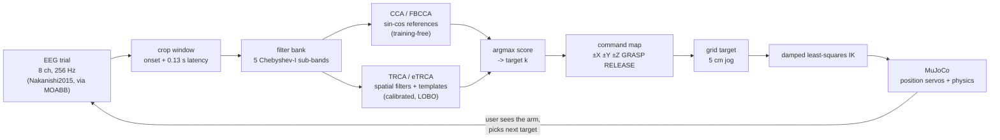
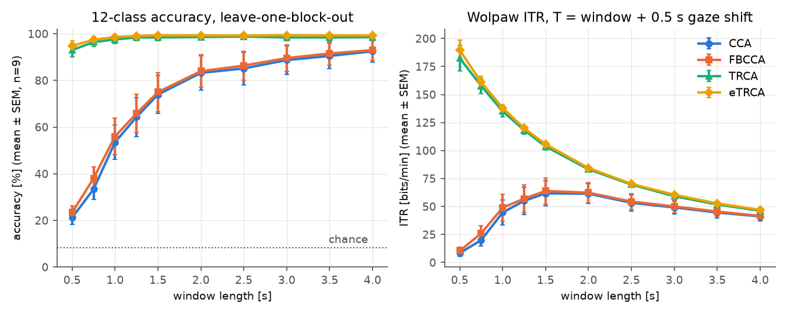
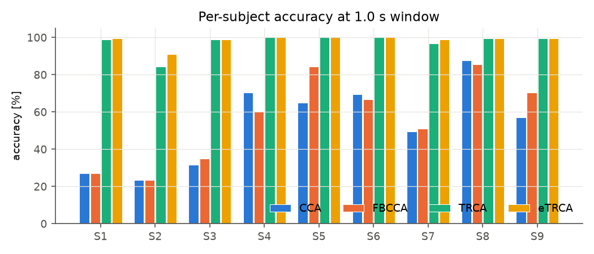
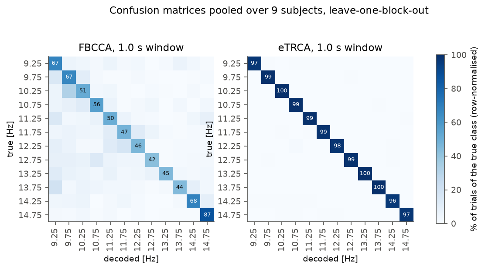
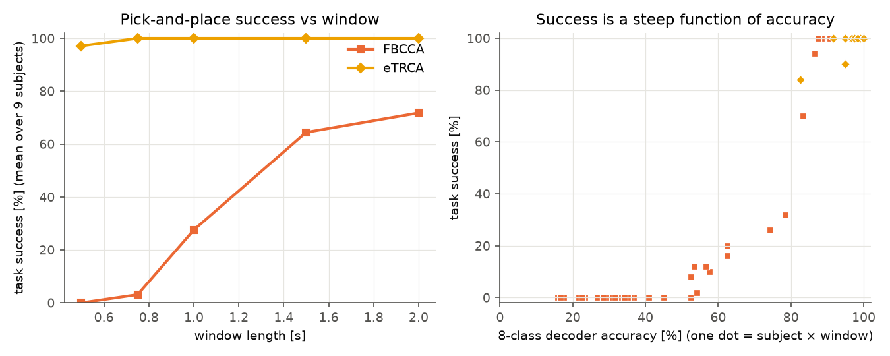
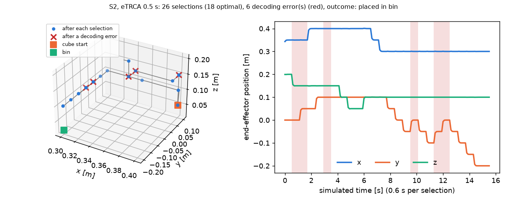

# ssvep-robot

**Brain-to-robot, end to end, on real EEG.** SSVEP decoding with standard CCA,
filter-bank CCA, TRCA and ensemble TRCA on a public 12-target dataset, benchmarked
with leave-one-block-out cross-validation, then used to drive a MuJoCo robot arm
through a pick-and-place task by replaying *real recorded, held-out trials*.


*One closed-loop episode: every command the arm executes is what eTRCA decoded from a
real held-out EEG trial of the intended class (a decoding error is shown in red).*



## Why I built this

<!-- TODO(Tommaso): dictate 3-4 lines in your own words -->

## Results

All numbers below are produced by the scripts in this repo
(`results/benchmark.csv`, `results/robot.csv`); nothing is copied from papers.

### Decoding: 12-class accuracy and ITR (9 subjects, leave-one-block-out)

| Method | Acc 0.5 s | Acc 1 s | Acc 2 s | Acc 4 s | ITR max (window) |
|---|---|---|---|---|---|
| CCA | 21.2 ± 2.8 | 53.5 ± 7.4 | 83.2 ± 7.3 | 92.5 ± 4.6 | 61.7 bits/min (1.5 s) |
| FBCCA | 23.4 ± 2.8 | 56.0 ± 7.8 | 84.0 ± 7.0 | 93.0 ± 4.4 | 63.9 bits/min (1.5 s) |
| TRCA | 93.0 ± 3.0 | 97.5 ± 1.7 | 98.6 ± 1.3 | 98.5 ± 1.3 | 182.6 bits/min (0.5 s) |
| eTRCA | 94.8 ± 2.2 | 98.6 ± 0.9 | 99.3 ± 0.7 | 99.3 ± 0.7 | 189.6 bits/min (0.5 s) |

Mean ± SEM across 9 subjects. ITR uses $T$ = window + 0.5 s gaze shift (the value used in
the authors' reference code); chance = 8.3 %.







**What the numbers say.**
- **Short windows are where calibration wins.** The 12 targets are only 0.5 Hz apart. Frequency
  alone needs roughly $1/\Delta f = 2$ s of data to separate neighbours, so CCA and FBCCA sit at
  21–23 % at 0.5 s and only pass 80 % at 2 s. TRCA uses individual templates, which carry the
  stimulus *phase* (the JFPM code) and the subject's own SSVEP waveform. It reaches 93–95 % at 0.5 s.
- **eTRCA ≥ TRCA at every window**, with the gap largest at 0.5 s (94.8 vs 93.0 %).
- **FBCCA only slightly beats CCA here** (about +2 points at 0.5–1 s). That is a smaller gain than
  Chen et al. report. Their dataset was different (40 targets, more channels), so this is not a contradiction. Treat it as a dataset-dependent effect.
- **Peak ITR** for eTRCA is at the shortest window we tested (0.5 s). The true optimum may be
  shorter. We did not go below 0.5 s.
- **Large between-subject spread for CCA** (23–88 % at 1 s, see the per-subject plot). TRCA
  removes most of it.

**Comparison with the literature (trends only).**
- Nakanishi et al. (2015) introduced this dataset to compare CCA-based detectors and found
  that methods using individual calibration data clearly beat standard CCA, with the
  largest gap at short windows. We reproduce that ordering. For their exact numbers, see the paper.
- Chen et al. (2015) report that FBCCA beats standard CCA (on a 40-target, 0.2 Hz-spaced
  dataset, not this one). See the paper for numbers.
- Nakanishi et al. (2018) report that ensemble TRCA beats TRCA and the CCA-based methods,
  and that the gain is largest at short windows. We see the same thing here. See the paper for numbers.

### Robot: pick-and-place driven by replayed real trials

| Method | Window | 8-class acc | ITR (8 targets) | Task success | Time to finish (successes) |
|---|---|---|---|---|---|
| FBCCA | 0.5 s | 26.9 % | 7.7 bits/min | 0.0 % | – |
| FBCCA | 0.75 s | 36.9 % | 16.2 bits/min | 3.1 % | 41.4 s |
| FBCCA | 1 s | 56.6 % | 37.8 bits/min | 27.6 % | 38.6 s |
| FBCCA | 1.5 s | 76.9 % | 53.6 bits/min | 64.4 % | 42.7 s |
| FBCCA | 2 s | 86.4 % | 53.5 bits/min | 71.8 % | 53.5 s |
| eTRCA | 0.5 s | 96.1 % | 161.9 bits/min | 97.1 % | 19.2 s |
| eTRCA | 0.75 s | 98.7 % | 138.7 bits/min | 100.0 % | 23.1 s |
| eTRCA | 1 s | 99.5 % | 118.2 bits/min | 100.0 % | 27.2 s |
| eTRCA | 1.5 s | 99.7 % | 89.2 bits/min | 100.0 % | 36.1 s |
| eTRCA | 2 s | 99.8 % | 71.5 bits/min | 100.0 % | 45.1 s |

Mean over 9 subjects × 50 episodes per condition. The task needs
18 error-free selections, and the budget is 2× that. "Time" is selections ×
(window + 0.5 s), counted on successful episodes only.





**What the numbers say.**
- Task success is a **steep, non-linear function of accuracy**. One drop ends the episode, and every
  wrong jog costs two selections (the error and its correction). Below ~50 % 8-class accuracy, no
  episode finishes inside the budget. Above ~90 %, essentially all do.
- **eTRCA at 0.5 s**: 97.1 % success, about 19 s per pick-and-place (error-free: 18 s). The 2.9 %
  failures are all cube drops (12/450 episodes), caused by RELEASE being decoded while carrying.
  Longer windows remove them, but each episode takes longer.
- **FBCCA**: 0 % at 0.5 s and 72 % at 2 s. Most failures at short windows come from the exhausted
  budget, and from 1 s on about 10 % of episodes end in a drop. FBCCA's peak *ITR* is at 1.5 s, but the
  task needs more than bits/min. A single misdecoded RELEASE is irreversible, which ITR does not price in.
  A real system should confirm irreversible commands (e.g. two consecutive RELEASE detections). That is not implemented here.
- The arm tracked every commanded grid target to within 0.1 mm after each 0.6 s command, so all failures come
  from decoding and none from control.

## Data

**Nakanishi2015** (Nakanishi, Wang, Wang & Jung, *PLoS ONE* 10(10):e0140703, 2015,
[doi:10.1371/journal.pone.0140703](https://doi.org/10.1371/journal.pone.0140703)).
12 targets, joint frequency–phase modulation (9.25–14.75 Hz in 0.5 Hz steps, phases
0/0.5π/π/1.5π), 8 occipital channels (PO7, PO3, POz, PO4, PO8, O1, Oz, O2), 256 Hz,
15 blocks of 12 trials per subject, 4 s of stimulation per trial. MOABB exposes 9 subjects.
The data is downloaded through MOABB (`Nakanishi2015().data_path`, source
[mnakanishi/12JFPM_SSVEP](https://github.com/mnakanishi/12JFPM_SSVEP)). The raw `eeg` tensor
is then read with SciPy because leave-one-block-out needs the block index. Stimulus onset
is at the 39th sample (dataset README). We add a 0.13 s visual latency, following the authors'
[TRCA reference code](https://github.com/mnakanishi/TRCA-SSVEP).

The Tsinghua benchmark (Wang et al. 2017, 35 subjects, 40 targets) is **not** included.
Its 64-channel files add up to several GB, which is too heavy for this low-RAM, one-subject-at-a-time setup. It is the obvious next step.

## Methods

Notation: test trial $X \in \mathbb{R}^{N_c \times N_s}$ ($N_c$ channels, $N_s$ samples),
$K$ targets with frequencies $f_k$.

### Standard CCA (Lin et al., 2006)

Reference for target $k$ with $N_h$ harmonics:

$$
Y_k = \big[\sin(2\pi f_k t),\ \cos(2\pi f_k t),\ \dots,\ \sin(2\pi N_h f_k t),\ \cos(2\pi N_h f_k t)\big]^\top
\in \mathbb{R}^{2N_h \times N_s}
$$

$$
\rho_k = \max_{w_x, w_y}
\frac{w_x^\top X Y_k^\top w_y}
{\sqrt{w_x^\top X X^\top w_x \; w_y^\top Y_k Y_k^\top w_y}},
\qquad \hat k = \arg\max_k \rho_k .
$$

Computed as the largest singular value of $Q_x^\top Q_y$, where $Q_x, Q_y$ are thin-QR
orthonormal bases of the centred $X^\top$ and $Y_k^\top$ (Björck & Golub). There is no matrix
inversion. $N_h = 5$, band-pass 6–90 Hz. No training.

### Filter-bank CCA (Chen et al., 2015)

$N=5$ sub-bands $X^{(m)}$ (Chebyshev-I, passband $[8m-2,\ 90]$ Hz, zero-phase):

$$
\tilde\rho_k = \sum_{m=1}^{N} w(m)\,\big(\rho_k^{(m)}\big)^2,
\qquad w(m) = m^{-a} + b,\quad a = 1.25,\ b = 0.25 .
$$

Higher sub-bands keep only the higher harmonics, so the fused score weights harmonic
information explicitly. No training.

### TRCA and ensemble TRCA (Nakanishi et al., 2018)

For class $k$ with centred training trials $X_h$, $h = 1..N_t$, find a spatial filter $w$
that makes the filtered trials $w^\top X_h$ as reproducible across trials as possible:

$$
S = \sum_{h_1 \neq h_2} X_{h_1} X_{h_2}^\top
  = \Big(\sum_h X_h\Big)\Big(\sum_h X_h\Big)^\top - \sum_h X_h X_h^\top,
\qquad
Q = \bar U \bar U^\top,\ \ \bar U = [X_1, \dots, X_{N_t}],
$$

$$
\hat w = \arg\max_w \frac{w^\top S w}{w^\top Q w}
\quad\Longleftrightarrow\quad
S\,w = \lambda\, Q\, w \ \ \text{(generalized eigenproblem, leading eigenvector).}
$$

Test score per sub-band: Pearson correlation between the filtered test trial and the
filtered class template $\bar X_k$ (training mean):

$$
r_k^{(m)} = \operatorname{corr}\!\big(W^\top X^{(m)},\ W^\top \bar X_k^{(m)}\big),
\qquad
\rho_k = \sum_m w(m)\, r_k^{(m)},
$$

with $W = w_k$ (TRCA) or $W = [w_1, \dots, w_K]$ (**ensemble TRCA**, 2-D correlation over the
flattened matrices). Calibration uses the other 14 blocks of the same subject.

### Information transfer rate (Wolpaw)

$$
B = \log_2 N + P\log_2 P + (1-P)\log_2\frac{1-P}{N-1}\ \ \text{bits/selection},
\qquad
\text{ITR} = B\cdot\frac{60}{T}\ \ \text{bits/min},
$$

with $T$ = window + gaze shift. This assumes equiprobable targets and errors spread
uniformly over the other $N-1$ targets.

### Robot: damped-least-squares IK

The arm (`ssvep_robot/robot/arm.xml`, written from scratch) has 4 joints: base yaw plus three pitch joints. It also has a 2-finger slide gripper.
The task stacks end-effector position with a soft "gripper points down" term
($a$ = hand axis, $a^* = -\hat z$, weight $\beta = 0.3$):

$$
e = \begin{bmatrix} p^* - p(q) \\ \beta\,(a \times a^*) \end{bmatrix},
\qquad
J = \begin{bmatrix} J_p \\ \beta J_r \end{bmatrix},
\qquad
\Delta q = J^\top\big(J J^\top + \lambda^2 I\big)^{-1} e,
$$

with $\lambda = 0.05$, iterated and clipped to joint limits. DLS minimises
$\lVert J\Delta q - e\rVert^2 + \lambda^2\lVert\Delta q\rVert^2$, so steps stay bounded
near singularities where the pseudo-inverse blows up. The price is an $O(\lambda^2)$
bias that the iteration removes. All 480 cells of the task grid are solved to < 0.1 mm.
Joint targets go to MuJoCo position servos (gravity-compensated links). Each command is held for 0.6 s
of simulated physics.

### Task and closed-loop user model

The 8 commands (`+X −X +Y −Y +Z −Z GRASP RELEASE`) are bound to the first 8 targets of the
dataset, and the decoder is retrained as an **8-class** problem. That way an error is always a
real wrong command, never a harmless idle target. A simulated user watches the arm and
always selects the command that best advances the task from the *current* state. A wrong jog is
therefore corrected later by the opposite jog. For each selection, a real trial of the intended
class is drawn from that subject. What the arm executes is the class the decoder assigned to that
trial when its block was held out. The episode fails if the cube is released outside the bin, or
if 2× the error-free number of selections is exceeded.

## Reproduce

```bash
python -m venv .venv && source .venv/bin/activate
pip install -e ".[data,media,dev]"
pytest -q                                   # unit tests, no downloads
python -m scripts.run_benchmark             # ~15 min on a laptop, one subject in RAM at a time
python -m scripts.run_robot --episodes 50   # MuJoCo replay + GIF (MUJOCO_GL=cgl on macOS, egl on Linux)
python -m scripts.make_figures
```

## Repository layout

```
ssvep_robot/
  data.py        dataset loading (MOABB download), epoch cropping
  filters.py     filter bank (Chebyshev-I, as in the authors' code), FB weights
  cca.py         standard CCA (Lin 2006)
  fbcca.py       filter-bank CCA (Chen 2015)
  trca.py        TRCA / ensemble TRCA (Nakanishi 2018)
  itr.py         Wolpaw ITR
  evaluate.py    leave-one-block-out evaluation
  robot/arm.xml  MJCF arm
  robot/ik.py    damped-least-squares IK
  robot/task.py  command map, task logic, closed-loop user model
  robot/sim.py   MuJoCo execution
scripts/         run_benchmark.py, run_robot.py, make_figures.py
tests/           CCA/FBCCA on synthetic sinusoids in noise, TRCA, ITR known values, IK convergence
```

## Limitations (read these)

- **Offline, cued data.** The trials were recorded with a cued paradigm. Gaze shifts, fatigue and the
  closed-loop distraction of watching a robot are not present. Online performance is usually lower.
- **The closed loop is simulated.** The user model is an idealised policy that never
  hesitates or mis-plans. Real trials are resampled with replacement from 15 per class.
- **Grasping is kinematic.** The cube is attached when the fingertip is within 3 cm. There is
  no contact-rich grasp physics and no collision checking against the bin walls.
- **9 subjects, one dataset.** The 40-target benchmark (Wang 2017) is not run.
- **No hyper-parameter tuning.** Harmonics, sub-bands, latency and gaze shift come from the
  original papers or code and are not fitted to this data. Results with other choices will differ.

## References

- Lin, Z., Zhang, C., Wu, W., Gao, X. (2006). Frequency recognition based on canonical correlation analysis for SSVEP-based BCIs. *IEEE TBME* 53(12):2610–2614. [doi:10.1109/TBME.2006.886577](https://doi.org/10.1109/TBME.2006.886577)
- Chen, X., Wang, Y., Gao, S., Jung, T.-P., Gao, X. (2015). Filter bank canonical correlation analysis for implementing a high-speed SSVEP-based brain–computer interface. *J. Neural Eng.* 12:046008. [doi:10.1088/1741-2560/12/4/046008](https://doi.org/10.1088/1741-2560/12/4/046008)
- Nakanishi, M., Wang, Y., Wang, Y.-T., Jung, T.-P. (2015). A comparison study of canonical correlation analysis based methods for detecting steady-state visual evoked potentials. *PLoS ONE* 10(10):e0140703. [doi:10.1371/journal.pone.0140703](https://doi.org/10.1371/journal.pone.0140703)
- Nakanishi, M., Wang, Y., Chen, X., Wang, Y.-T., Gao, X., Jung, T.-P. (2018). Enhancing detection of SSVEPs for a high-speed brain speller using task-related component analysis. *IEEE TBME* 65(1):104–112. [doi:10.1109/TBME.2017.2694818](https://doi.org/10.1109/TBME.2017.2694818)
- Wolpaw, J. R., Birbaumer, N., McFarland, D. J., Pfurtscheller, G., Vaughan, T. M. (2002). Brain–computer interfaces for communication and control. *Clin. Neurophysiol.* 113(6):767–791.
- Jayaram, V., Barachant, A. (2018). MOABB: trustworthy algorithm benchmarking for BCIs. *J. Neural Eng.* 15:066011.
- Todorov, E., Erez, T., Tassa, Y. (2012). MuJoCo: A physics engine for model-based control. *IROS*.

## License

MIT © 2026 Tommaso Maggiolo. Dataset and papers belong to their respective authors. Please cite them.
