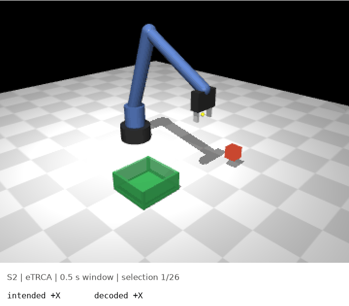

# flicker2grasp



A MuJoCo arm doing pick-and-place, driven by SSVEP decoding of real held-out EEG trials from a public 12-target dataset. Every command it executes is what the decoder output for a real trial of the intended class; decoding errors show in red. With ensemble TRCA on 0.5 s windows the arm finishes 97.1 % of episodes in about 19 s, while filter-bank CCA on the same windows never finishes one.

<!-- TODO(Tommaso): dictate 3-4 lines in your own words -->

## Reproduce

```bash
python -m venv .venv && source .venv/bin/activate
pip install -e ".[data,media,dev]"
pytest -q                                   # unit tests, no downloads
python -m scripts.run_benchmark             # ~15 min on a laptop, one subject in RAM at a time
python -m scripts.run_robot --episodes 50   # MuJoCo replay + GIF (MUJOCO_GL=cgl on macOS, egl on Linux)
python -m scripts.make_figures
```

Results land in `results/benchmark.csv` and `results/robot.csv`. The decoders are in `ssvep_robot/` (`cca.py`, `fbcca.py`, `trca.py`), the arm and IK in `ssvep_robot/robot/`.

## Results

12-class accuracy (%) and peak ITR, 9 subjects, leave-one-block-out, mean ± SEM. Chance is 8.3 %. ITR uses $T$ = window + 0.5 s gaze shift, as in the authors' reference code.

| Method | 0.5 s | 1 s | 2 s | 4 s | ITR max (window) |
|---|---|---|---|---|---|
| CCA | 21.2 ± 2.8 | 53.5 ± 7.4 | 83.2 ± 7.3 | 92.5 ± 4.6 | 61.7 bits/min (1.5 s) |
| FBCCA | 23.4 ± 2.8 | 56.0 ± 7.8 | 84.0 ± 7.0 | 93.0 ± 4.4 | 63.9 bits/min (1.5 s) |
| TRCA | 93.0 ± 3.0 | 97.5 ± 1.7 | 98.6 ± 1.3 | 98.5 ± 1.3 | 182.6 bits/min (0.5 s) |
| eTRCA | 94.8 ± 2.2 | 98.6 ± 0.9 | 99.3 ± 0.7 | 99.3 ± 0.7 | 189.6 bits/min (0.5 s) |

The 12 targets are only 0.5 Hz apart, so frequency alone needs roughly $1/\Delta f = 2$ s to separate neighbours, which is where CCA and FBCCA finally pass 80 %. TRCA's individual templates also carry the stimulus phase and the subject's own SSVEP waveform, and that buys 93–95 % at 0.5 s. eTRCA peaks at the shortest window tested; we didn't go below 0.5 s. FBCCA beats CCA by only about 2 points here, less than Chen et al. report on their 40-target dataset. The ordering (calibrated methods win, most at short windows; eTRCA ≥ TRCA) matches Nakanishi et al. (2015, 2018).

On the robot (8 classes, 9 subjects × 50 episodes per condition), task success is a steep function of accuracy, since every wrong jog costs two selections and one wrong RELEASE drops the cube. FBCCA goes from 0.0 % success at 0.5 s to 71.8 % at 2 s. eTRCA reaches 97.1 % at 0.5 s and 100.0 % from 0.75 s on. Its 0.5 s failures are all cube drops (12/450 episodes) from RELEASE decoded while carrying. FBCCA's ITR peaks at 1.5 s, but ITR doesn't price an irreversible command; a real system should confirm RELEASE, which isn't implemented here. The arm reached every commanded grid target within 0.1 mm, so all failures come from decoding. Full table in [`results/table_robot.md`](results/table_robot.md).

## Methods

The data is Nakanishi2015 (via MOABB, 9 subjects): 12 targets with joint frequency–phase modulation, 9.25–14.75 Hz in 0.5 Hz steps, 8 occipital channels at 256 Hz, 15 blocks of 12 four-second trials. The raw tensor is read with SciPy because leave-one-block-out needs the block index, and windows start at stimulus onset plus a 0.13 s visual latency, following the authors' [TRCA code](https://github.com/mnakanishi/TRCA-SSVEP).

For a test trial $X \in \mathbb{R}^{N_c \times N_s}$, standard CCA (Lin et al., 2006) compares it against sine–cosine references $Y_k$ with $N_h = 5$ harmonics of each target frequency $f_k$:

$$
\rho_k = \max_{w_x, w_y}
\frac{w_x^\top X Y_k^\top w_y}
{\sqrt{w_x^\top X X^\top w_x \; w_y^\top Y_k Y_k^\top w_y}},
\qquad \hat k = \arg\max_k \rho_k ,
$$

computed without matrix inversion as the largest singular value of $Q_x^\top Q_y$, the thin-QR bases of the centred $X^\top$ and $Y_k^\top$. FBCCA (Chen et al., 2015) repeats this on 5 Chebyshev-I sub-bands with passband $[8m-2,\ 90]$ Hz and fuses $\tilde\rho_k = \sum_m (m^{-1.25} + 0.25)\,(\rho_k^{(m)})^2$, so higher harmonics get weighted explicitly. Neither needs training.

TRCA (Nakanishi et al., 2018) learns, per class, a spatial filter that makes filtered training trials $w^\top X_h$ as reproducible across trials as possible:

$$
S = \Big(\sum_h X_h\Big)\Big(\sum_h X_h\Big)^\top - \sum_h X_h X_h^\top,
\qquad
Q = \bar U \bar U^\top,
\qquad
S\,w = \lambda\, Q\, w ,
$$

taking the leading generalized eigenvector. A test trial is scored by the correlation between $W^\top X^{(m)}$ and the filtered class template $W^\top \bar X_k^{(m)}$, summed over sub-bands with the FBCCA weights. TRCA uses $W = w_k$; ensemble TRCA stacks all class filters, $W = [w_1, \dots, w_K]$. Calibration uses the subject's other 14 blocks. ITR is Wolpaw's $B = \log_2 N + P\log_2 P + (1-P)\log_2\frac{1-P}{N-1}$ bits per selection times $60/T$.

The arm (`ssvep_robot/robot/arm.xml`) has base yaw, three pitch joints and a 2-finger slide gripper. Damped least-squares IK stacks position error with a soft "gripper points down" term ($a$ = hand axis, $\beta = 0.3$):

$$
e = \begin{bmatrix} p^* - p(q) \\ \beta\,(a \times (-\hat z)) \end{bmatrix},
\qquad
\Delta q = J^\top\big(J J^\top + \lambda^2 I\big)^{-1} e, \quad \lambda = 0.05 ,
$$

iterated and clipped to joint limits. The damping keeps steps bounded near singularities, and the iteration removes its $O(\lambda^2)$ bias; all 480 grid cells solve to < 0.1 mm. Joint targets go to MuJoCo position servos, held for 0.6 s per command.

The 8 commands (`+X −X +Y −Y +Z −Z GRASP RELEASE`) are bound to the first 8 dataset targets and the decoder is retrained as an 8-class problem, so every error is a real wrong command. A simulated user always picks the command that best advances the task from the current state. For each selection a real trial of that class is drawn, and the arm executes whatever the decoder assigned it when its block was held out. An episode fails on a drop outside the bin or after 2× the 18 error-free selections.

## Limitations

- Offline, cued data. No gaze shifts, fatigue or distraction from watching a robot. Online performance is usually lower.
- The closed loop is simulated with an idealised user who never hesitates. Real trials are resampled with replacement from 15 per class.
- Grasping is kinematic: the cube attaches within 3 cm of the fingertip. No contact physics, no collision checking against the bin.
- 9 subjects, one dataset. The 40-target Tsinghua benchmark (Wang et al. 2017) is several GB and isn't run.
- No hyper-parameter tuning. Harmonics, sub-bands, latency and gaze shift come from the original papers and code.

## References

- Lin, Z., Zhang, C., Wu, W., Gao, X. (2006). Frequency recognition based on canonical correlation analysis for SSVEP-based BCIs. *IEEE TBME* 53(12):2610–2614. [doi:10.1109/TBME.2006.886577](https://doi.org/10.1109/TBME.2006.886577)
- Chen, X., Wang, Y., Gao, S., Jung, T.-P., Gao, X. (2015). Filter bank canonical correlation analysis for implementing a high-speed SSVEP-based brain–computer interface. *J. Neural Eng.* 12:046008. [doi:10.1088/1741-2560/12/4/046008](https://doi.org/10.1088/1741-2560/12/4/046008)
- Nakanishi, M., Wang, Y., Wang, Y.-T., Jung, T.-P. (2015). A comparison study of canonical correlation analysis based methods for detecting steady-state visual evoked potentials. *PLoS ONE* 10(10):e0140703. [doi:10.1371/journal.pone.0140703](https://doi.org/10.1371/journal.pone.0140703)
- Nakanishi, M., Wang, Y., Chen, X., Wang, Y.-T., Gao, X., Jung, T.-P. (2018). Enhancing detection of SSVEPs for a high-speed brain speller using task-related component analysis. *IEEE TBME* 65(1):104–112. [doi:10.1109/TBME.2017.2694818](https://doi.org/10.1109/TBME.2017.2694818)
- Wolpaw, J. R., Birbaumer, N., McFarland, D. J., Pfurtscheller, G., Vaughan, T. M. (2002). Brain–computer interfaces for communication and control. *Clin. Neurophysiol.* 113(6):767–791.
- Jayaram, V., Barachant, A. (2018). MOABB: trustworthy algorithm benchmarking for BCIs. *J. Neural Eng.* 15:066011.
- Todorov, E., Erez, T., Tassa, Y. (2012). MuJoCo: A physics engine for model-based control. *IROS*.

MIT © 2026 Tommaso Maggiolo. Dataset and papers belong to their respective authors; please cite them.
